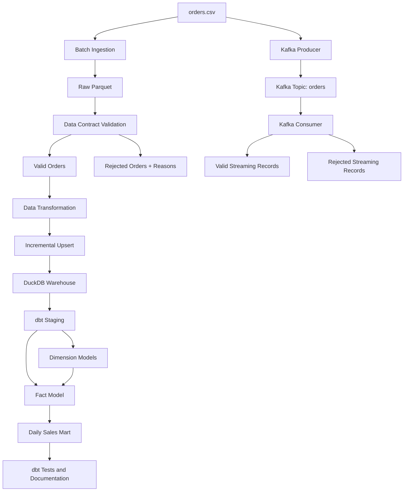

# Data Processing Workflow — UTS

## End-to-End Event-to-Warehouse Pipeline: Analisis Transaksi E-Commerce

Proyek ini membangun pipeline pemrosesan data transaksi pesanan (*orders*) dari proses batch hingga streaming. Pipeline mencakup ingestion, validasi data contract, transformasi, pengujian performa Pandas dan Polars, pemrosesan event menggunakan Apache Kafka, penyimpanan analitik di DuckDB, serta pemodelan data dan pengujian kualitas menggunakan dbt.

Dataset yang digunakan merupakan data sintetis untuk keperluan pembelajaran.

## Daftar Isi

1. [Tujuan Proyek](#1-tujuan-proyek)
2. [Arsitektur Pipeline](#2-arsitektur-pipeline)
3. [Teknologi](#3-teknologi)
4. [Struktur Proyek](#4-struktur-proyek)
5. [Persiapan Lingkungan](#5-persiapan-lingkungan)
6. [Batch Ingestion dan Validasi](#6-batch-ingestion-dan-validasi)
7. [Transformasi Data](#7-transformasi-data)
8. [Incremental Loading dan Idempotensi](#8-incremental-loading-dan-idempotensi)
9. [Kafka Streaming](#9-kafka-streaming)
10. [Benchmark Pandas dan Polars](#10-benchmark-pandas-dan-polars)
11. [Eksperimen Data Skew](#11-eksperimen-data-skew)
12. [DuckDB dan Data Warehouse](#12-duckdb-dan-data-warehouse)
13. [dbt, Data Quality, dan Dokumentasi](#13-dbt-data-quality-dan-dokumentasi)
14. [Pertanyaan Analitik](#14-pertanyaan-analitik)
15. [Ringkasan Hasil Pengujian](#15-ringkasan-hasil-pengujian)
16. [Keputusan Desain dan Keterbatasan](#16-keputusan-desain-dan-keterbatasan)

---

## 1. Tujuan Proyek

Proyek ini bertujuan menerapkan alur kerja data engineering dari sumber transaksi sampai lapisan analitik.

Tujuan utamanya meliputi:

- Mengambil data pesanan dan menyimpannya dalam format Parquet.
- Memvalidasi data menggunakan aturan data contract dan memisahkan record yang tidak valid.
- Melakukan transformasi data dan menghasilkan nilai transaksi kotor serta bersih.
- Mendukung incremental loading dan menguji agar proses berulang tidak menambahkan data yang sama secara tidak semestinya.
- Memproses event transaksi melalui Apache Kafka.
- Membandingkan performa Pandas, Polars eager, dan Polars lazy.
- Menguji pengaruh distribusi data yang tidak seimbang (*data skew*).
- Menyimpan data analitik pada DuckDB.
- Membangun model dimensional, menjalankan pengujian kualitas data, dan menghasilkan dokumentasi menggunakan dbt.

## 2. Arsitektur Pipeline

Pipeline mengintegrasikan pemrosesan batch dan streaming ke dalam alur analitik.



Diagram ini menunjukkan komponen utama proyek secara logis. Jalur batch dan streaming memiliki artefak keluaran masing-masing; jangan menganggap seluruh record streaming otomatis masuk ke warehouse batch tanpa proses pemuatan yang sesuai.

## 3. Teknologi

| Teknologi | Penggunaan |
|---|---|
| Python | Menjalankan proses ingestion, validasi, transformasi, dan analisis |
| Pandas | Transformasi dan benchmark data |
| Polars | Transformasi eager/lazy dan eksperimen performa |
| Parquet | Penyimpanan data tabular |
| JSONL | Penyimpanan record streaming dan rejected |
| Apache Kafka | Pengiriman dan pemrosesan event transaksi |
| Docker Compose | Menjalankan broker Kafka |
| DuckDB | Database analitik lokal |
| dbt Core | Pemodelan data dan pengujian kualitas |
| dbt-duckdb | Adapter dbt untuk DuckDB |

## 4. Struktur Proyek

Struktur utama proyek UTS:

```text
UTS/
├── data/
│   ├── orders.csv
│   ├── raw/
│   │   └── orders.parquet
│   ├── processed/
│   │   ├── valid_orders.parquet
│   │   ├── transformed_orders.parquet
│   │   ├── validation_summary.json
│   │   ├── transformation_summary.json
│   │   └── daily_sales.csv
│   ├── rejected/
│   │   └── rejected_orders.jsonl
│   └── streaming/
│       ├── valid_orders.jsonl
│       └── rejected_orders.jsonl
│
├── scripts/
│   ├── batch_ingest.py
│   ├── batch_ingest_backup.py
│   ├── validate_orders.py
│   ├── transform_orders.py
│   ├── incremental_upsert.py
│   ├── kafka_producer.py
│   ├── kafka_consumer.py
│   ├── benchmark_engines.py
│   ├── benchmark_skew.py
│   ├── setup_duckdb.py
│   └── analyze_sales.py
│
├── dbt_project/
│   ├── dbt_project.yml
│   └── models/
│       ├── staging/
│       │   ├── source.yml
│       │   ├── stg_orders.sql
│       │   └── stg_orders.yml
│       └── marts/
│           ├── dim_customer.sql
│           ├── dim_product_category.sql
│           ├── fct_orders.sql
│           ├── mart_daily_sales.sql
│           └── schema.yml
│
├── docker-compose.yml
├── requirements.txt
├── analytics.duckdb
└── README.md
```

Folder `.venv` dapat digunakan untuk lingkungan Python lokal dan tidak perlu disertakan dalam repository pengumpulan apabila tidak diwajibkan.

## 5. Persiapan Lingkungan

### 5.1. Masuk ke folder proyek

Jalankan perintah berikut melalui Windows PowerShell:

```powershell
cd "D:\Sem 5\Data Processing Workflow\tugas\praktikum\UTS"
```

### 5.2. Aktifkan virtual environment

Jika virtual environment berada di root proyek:

```powershell
.\.venv\Scripts\Activate.ps1
```

Jika environment sudah aktif, langkah ini tidak perlu diulangi.

### 5.3. Instal dependensi

```powershell
python -m pip install -r requirements.txt
```

Periksa versi Python dan Docker:

```powershell
python --version
docker --version
docker compose version
```

Apabila ada dependensi yang belum tercantum di `requirements.txt`, instal sesuai kebutuhan skrip yang digunakan.

## 6. Batch Ingestion dan Validasi

### 6.1. Batch ingestion

Skrip utama: `scripts/batch_ingest.py`

Skrip ini digunakan untuk mengambil data pesanan dari sumber CSV dan menghasilkan data mentah dalam format Parquet. Proses ingestion juga berkaitan dengan mekanisme pagination, retry, watermark, dan incremental loading yang diuji dalam proyek.

Jalankan dari root proyek:

```powershell
python .\scripts\batch_ingest.py
```

Artefak utama:

- `data/orders.csv`
- `data/raw/orders.parquet`

### 6.2. Validasi data contract

Skrip: `scripts/validate_orders.py`

Validasi digunakan untuk memeriksa apakah record memenuhi aturan yang ditetapkan sebelum digunakan dalam proses berikutnya.

Aturan validasi yang digunakan mencakup:

- `order_id` dan `customer_id` wajib tersedia.
- `quantity` harus berupa bilangan bulat positif.
- `unit_price` tidak boleh negatif.
- `discount_pct` harus berada pada rentang 0 sampai 1.
- `order_ts` harus dapat diproses sebagai timestamp.
- `status` harus termasuk salah satu dari `paid`, `shipped`, `cancelled`, atau `refunded`.

Jalankan:

```powershell
python .\scripts\validate_orders.py
```

Artefak hasil validasi:

- `data/processed/valid_orders.parquet`
- `data/rejected/rejected_orders.jsonl`
- `data/processed/validation_summary.json`

### 6.3. Hasil validasi

Dataset awal berisi 36 record. Hasil validasi batch yang tercatat adalah:

| Keterangan | Jumlah |
|---|---:|
| Total record awal | 36 |
| Record valid | 30 |
| Record rejected | 6 |

Record yang ditolak memiliki masalah berikut:

| Order ID | Penyebab penolakan |
|---|---|
| `O1031` | `quantity` bernilai nol |
| `O1032` | `unit_price` bernilai negatif |
| `O1033` | `discount_pct` melebihi 1 |
| `O1034` | Timestamp tidak valid |
| `O1035` | Status tidak termasuk nilai yang diizinkan |
| `O1036` | `customer_id` kosong |

File rejected menyimpan record yang tidak lolos validasi agar dapat diperiksa dan diaudit.

## 7. Transformasi Data

Skrip: `scripts/transform_orders.py`

Transformasi dilakukan untuk menyiapkan data pesanan agar dapat digunakan dalam analisis.

Rumus perhitungan:

```text
gross_amount = quantity * unit_price

net_amount = gross_amount * (1 - discount_pct)
```

Kolom `net_amount` menunjukkan nilai transaksi setelah diskon berdasarkan rumus yang digunakan.

Jalankan:

```powershell
python .\scripts\transform_orders.py
```

Artefak keluaran:

- `data/processed/transformed_orders.parquet`
- `data/processed/transformation_summary.json`
- `data/processed/daily_sales.csv`, jika dihasilkan oleh proses yang digunakan.

Hasil transformasi yang tercatat:

| Metrik | Hasil |
|---|---:|
| Record hasil transformasi | 30 |
| `order_id` unik | 30 |
| Total `gross_amount` | 4245.83 |
| Total `net_amount` | 3948.473 |
| Zona waktu timestamp | UTC |

Nilai tersebut merupakan hasil yang tercatat dari proses sebelumnya. Hasil saat dijalankan ulang perlu dicocokkan dengan output aktual.

## 8. Incremental Loading dan Idempotensi

Skrip: `scripts/incremental_upsert.py`

Incremental upsert digunakan untuk memproses pembaruan data berdasarkan identitas pesanan dan mekanisme watermark/lookback yang diterapkan dalam skrip.

Tujuannya adalah menghindari penambahan record yang sama secara berulang ketika proses ingestion dijalankan kembali.

Jalankan:

```powershell
python .\scripts\incremental_upsert.py
```

Pengujian yang terdokumentasi menunjukkan bahwa proses ingestion ulang mempertahankan jumlah 36 baris, bukan menambahkan duplikat baru.

Untuk pengujian berikutnya, periksa juga:

- Nilai watermark sebelum dan sesudah proses.
- Jumlah record yang dibaca dan ditambahkan.
- Perilaku upsert ketika `order_id` yang sama muncul kembali.
- Apakah file checkpoint dan data uji terpisah dari artefak utama.

## 9. Kafka Streaming

### 9.1. Konfigurasi broker

Kafka dijalankan menggunakan Docker Compose dengan konfigurasi yang tercatat:

| Konfigurasi | Nilai |
|---|---|
| Image Kafka | `apache/kafka:3.9.0` |
| Container/service yang tercatat | `dpw-kafka` |
| Port host | `9092` |
| Topic | `orders` |
| Jumlah partition | 3 |
| Replication factor | 1 |

### 9.2. Menjalankan Kafka

Dari root proyek:

```powershell
docker compose config
docker compose up -d
docker compose ps
```

Pastikan broker berjalan sebelum producer dan consumer dijalankan.

### 9.3. Producer dan consumer

Skrip yang digunakan:

- `scripts/kafka_producer.py`
- `scripts/kafka_consumer.py`

Producer mengirimkan event pesanan ke topic `orders`. Consumer membaca event, memvalidasi data, dan memisahkan hasil menjadi record valid serta rejected.

Jalankan consumer terlebih dahulu di satu terminal:

```powershell
python .\scripts\kafka_consumer.py
```

Kemudian jalankan producer di terminal PowerShell kedua:

```powershell
python .\scripts\kafka_producer.py
```

Perintah di atas berlaku apabila skrip tidak membutuhkan argumen wajib. Jika skrip memiliki opsi CLI, ikuti argumen yang didefinisikan dalam kode atau tampilkan bantuan menggunakan `--help` apabila didukung.

### 9.4. Hasil streaming yang tercatat

| Keterangan | Hasil |
|---|---:|
| Event yang dikirim producer | 36 |
| Record valid yang diproses | 30 |
| Record rejected | 6 |
| Duplikat yang diuji | `O1001` |
| Hasil penanganan duplikat | `DUPLICATE_IGNORED` |

Artefak streaming:

- `data/streaming/valid_orders.jsonl`
- `data/streaming/rejected_orders.jsonl`

### 9.5. Partition, consumer group, dan offset

- **Partition** membagi topic menjadi beberapa bagian agar event dapat disimpan dan diproses secara paralel.
- **Consumer group** mengatur pembagian partition di antara consumer yang memiliki group ID yang sama.
- **Offset** menunjukkan posisi event yang telah dibaca oleh consumer.
- **At-least-once** memungkinkan pesan diproses ulang ketika terjadi kegagalan.
- **Exactly-once** memerlukan jaminan tambahan agar pemrosesan dan perubahan pada tujuan konsisten tanpa efek ganda.

Implementasi yang tercatat melakukan commit offset setelah penulisan ke sink. Pola ini memberikan karakteristik at-least-once; hal tersebut tidak berarti seluruh pipeline memiliki jaminan exactly-once end-to-end.

Matikan broker setelah pengujian selesai:

```powershell
docker compose down
```

## 10. Benchmark Pandas dan Polars

Skrip: `scripts/benchmark_engines.py`

Benchmark membandingkan waktu eksekusi Pandas, Polars eager, dan Polars lazy menggunakan data yang sama.

### 10.1. Hasil benchmark dataset asli

Dataset benchmark berisi 36 baris dengan ukuran file Parquet sekitar 6.770 byte. Pengukuran dilakukan sebanyak 10 kali.

| Implementasi | Median | Rata-rata |
|---|---:|---:|
| Pandas | 7.787 ms | 11.255 ms |
| Polars eager | 3.671 ms | 4.316 ms |
| Polars lazy | 6.003 ms | 5.728 ms |

Hasil perhitungan yang dibandingkan tercatat setara.

Pada dataset kecil ini, Polars eager memiliki median waktu terendah. Namun, hasil tersebut tidak dapat langsung digeneralisasi ke dataset besar atau lingkungan produksi.

### 10.2. Menjalankan benchmark

```powershell
python .\scripts\benchmark_engines.py
```

Gunakan output aktual dan file hasil yang dihasilkan skrip sebagai bukti benchmark.

## 11. Eksperimen Data Skew

Skrip: `scripts/benchmark_skew.py`

Eksperimen ini membandingkan pemrosesan data dengan distribusi normal dan distribusi yang didominasi satu grup.

Konfigurasi yang tercatat:

- Dataset normal: 3.600 baris.
- Dataset skewed: 3.600 baris.
- Grup dominan: `C_SKEW_DOMINANT`.
- Jumlah record pada grup dominan: 3.564 atau sekitar 99%.

### Hasil median waktu

| Distribusi | Pandas | Polars eager | Polars lazy |
|---|---:|---:|---:|
| Normal | 31.341 ms | 1.639 ms | 1.899 ms |
| Skewed | 32.404 ms | 1.218 ms | 1.780 ms |

Dalam eksperimen ini, distribusi skew tidak secara konsisten meningkatkan waktu agregasi. Tidak ada kejadian out-of-memory (OOM) yang tercatat.

Kesimpulan dibatasi pada dataset dan lingkungan pengujian tersebut. Hasil ini tidak membuktikan bahwa data skew tidak akan memengaruhi performa pada skala yang lebih besar.

Jalankan eksperimen menggunakan:

```powershell
python .\scripts\benchmark_skew.py
```

## 12. DuckDB dan Data Warehouse

Database analitik tersimpan di:

```text
analytics.duckdb
```

Skrip penyiapan database:

```text
scripts/setup_duckdb.py
```

Database menggunakan tabel sumber `raw.raw_orders`, yang tercatat berisi 30 record valid setelah proses transformasi.

### 12.1. Menyiapkan database

```powershell
python .\scripts\setup_duckdb.py
```

Jalankan dari root proyek dan periksa isi skrip sebelum mengulang proses penyiapan, terutama jika proses tersebut membuat ulang atau menimpa tabel.

### 12.2. Tabel warehouse yang tercatat

| Tabel | Jumlah baris | Kegunaan |
|---|---:|---|
| `mart.dim_customer` | 25 | Dimensi pelanggan |
| `mart.dim_product_category` | 4 | Dimensi kategori produk |
| `mart.fct_orders` | 30 | Fakta transaksi pesanan |
| `mart.mart_daily_sales` | 28 | Agregasi penjualan harian |

Agregasi `mart_daily_sales` yang tercatat menggunakan transaksi dengan status `paid` dan `shipped`. Oleh karena itu, angka agregasi tersebut tidak selalu sama dengan total semua transaksi dalam tabel sumber.

### 12.3. Memeriksa database

Dari root proyek:

```powershell
python -c "import duckdb; c=duckdb.connect('analytics.duckdb', read_only=True); print(c.execute('SHOW SCHEMAS').fetchall()); c.close()"
```

Untuk melihat kolom tabel sumber:

```powershell
python -c "import duckdb; c=duckdb.connect('analytics.duckdb', read_only=True); print(c.execute('DESCRIBE raw.raw_orders').df().to_string(index=False)); c.close()"
```

## 13. dbt, Data Quality, dan Dokumentasi

Proyek dbt berada di folder:

```text
dbt_project/
```

Konfigurasi menggunakan profil `uts_analytics` dan adapter `dbt-duckdb`. Path database dikonfigurasi relatif terhadap direktori proyek dbt.

### 13.1. Model dbt

| Model | Kegunaan |
|---|---|
| `stg_orders` | Standardisasi dan persiapan data pesanan |
| `dim_customer` | Dimensi pelanggan |
| `dim_product_category` | Dimensi kategori produk |
| `fct_orders` | Tabel fakta pesanan |
| `mart_daily_sales` | Agregasi penjualan harian |

### 13.2. Menjalankan dbt

Masuk ke folder proyek:

```powershell
cd .\dbt_project
```

Periksa koneksi dan konfigurasi:

```powershell
dbt debug
dbt parse
dbt ls
```

Bangun model dan jalankan pengujian:

```powershell
dbt run
dbt test
```

Hasil yang tercatat:

- 5 model berhasil dijalankan.
- 12 pengujian dbt lulus.
- 0 pengujian gagal.
- 0 error pada hasil pengujian tersebut.

### 13.3. Pengujian kualitas data

Tes mencakup:

- `unique` untuk identitas yang seharusnya unik.
- `not_null` untuk kolom yang wajib diisi.
- `relationships` untuk memeriksa hubungan antara tabel fakta dan tabel dimensi.

Pengujian relasi mencakup `customer_id` pada fakta pesanan terhadap dimensi pelanggan serta `product_category` terhadap dimensi kategori produk.

### 13.4. Dokumentasi dbt

Dari folder `dbt_project`:

```powershell
dbt docs generate
dbt docs serve
```

`dbt docs generate` menghasilkan artefak dokumentasi model dan kolom. `dbt docs serve` menjalankan server dokumentasi lokal; buka URL yang ditampilkan di terminal.

Catatan: skema yang dibangun dbt dapat berbeda dari tabel warehouse yang dibuat sebelumnya. Konfigurasi dbt yang tercatat menggunakan skema seperti `main_staging` dan `main_mart`, sedangkan tabel langsung yang telah dibuat sebelumnya berada pada skema `mart`. Periksa skema aktual sebelum membandingkan tabel-tabel tersebut.

## 14. Pertanyaan Analitik

Lapisan analitik dirancang untuk menjawab pertanyaan bisnis berikut:

1. Berapa nilai penjualan bersih per hari?
2. Kategori produk mana yang memiliki penjualan bersih tertinggi?
3. Bagaimana jumlah dan nilai pesanan menurut status?
4. Metode pembayaran mana yang paling sering digunakan?
5. Berapa banyak record yang ditolak oleh data contract, dan apa penyebab terbesarnya?

Pertanyaan tersebut dapat dianalisis menggunakan SQL pada DuckDB serta file rejected hasil validasi.

Skrip analisis penjualan yang tersedia di proyek adalah `scripts/analyze_sales.py`. Jalankan dari root proyek:

```powershell
python .\scripts\analyze_sales.py
```

Pastikan nama tabel, kolom, path file rejected, serta filter status pada query sesuai dengan implementasi aktual. Penjualan bersih harus menggunakan definisi `net_amount` yang konsisten agar diskon tidak dihitung dua kali.

## 15. Ringkasan Hasil Pengujian

| Komponen | Hasil yang tercatat |
|---|---|
| Batch ingestion | Dataset awal 36 record |
| Data contract | 30 valid dan 6 rejected |
| Transformasi | 30 record, 30 `order_id` unik |
| Total gross amount | 4245.83 |
| Total net amount | 3948.473 |
| Kafka | 36 event dikirim |
| Streaming validation | 30 valid dan 6 rejected |
| Penanganan duplikat | `O1001` diabaikan pada pengujian |
| Benchmark | Pandas, Polars eager, dan Polars lazy dibandingkan |
| Data skew | 3.600 baris pada masing-masing distribusi |
| dbt models | 5 model berhasil dijalankan |
| dbt tests | 12 lulus, 0 gagal |

Angka di atas merupakan hasil pengujian yang tercatat selama pengerjaan. Untuk pengumpulan akhir, pertahankan log, file hasil, dan bukti eksekusi yang mendukung setiap klaim.

## 16. Keputusan Desain dan Keterbatasan

### Keputusan desain

- **Parquet** digunakan untuk menyimpan data tabular dengan tipe data yang sesuai untuk pemrosesan analitik.
- **Data contract** digunakan untuk memisahkan record yang valid dan tidak valid sebelum data diteruskan.
- **Rejected records** disimpan untuk mendukung audit dan analisis penyebab kegagalan.
- **Kafka** digunakan untuk mendemonstrasikan pengiriman dan pemrosesan event secara streaming.
- **DuckDB** menyediakan warehouse lokal untuk query analitik.
- **dbt** memisahkan model staging dan mart serta menyediakan pengujian kualitas dan dokumentasi.
- **Pandas dan Polars** dibandingkan berdasarkan hasil pengukuran, bukan hanya asumsi performa.

### Keterbatasan

1. Dataset utama hanya berisi 36 record, sehingga hasil benchmark belum merepresentasikan beban produksi.
2. Hasil benchmark dapat dipengaruhi oleh perangkat, versi library, cache, dan beban sistem.
3. Eksperimen skew belum menunjukkan kejadian OOM; kesimpulan hanya berlaku pada konfigurasi yang diuji.
4. Jaminan Kafka yang tercatat bersifat at-least-once, bukan exactly-once end-to-end.
5. Pipeline batch dan streaming memiliki artefak keluaran terpisah; integrasi penuh keduanya ke warehouse harus mengikuti proses pemuatan yang benar-benar diterapkan.
6. Perbedaan skema antara tabel langsung dan model dbt perlu diperhatikan saat membandingkan hasil.
7. Hasil analisis bisnis bergantung pada definisi penjualan bersih dan filter status transaksi yang digunakan.


## Kesimpulan

Proyek ini berhasil mengimplementasikan alur Data Processing Workflow yang mencakup ingestion, validasi, transformasi, pemrosesan batch dan streaming menggunakan Kafka, serta analisis data dengan DuckDB dan dbt. Hasil pengujian menunjukkan bahwa pipeline dapat memproses data dan menjalankan pengujian kualitas dengan baik. Pengembangan selanjutnya dapat difokuskan pada pengujian menggunakan dataset yang lebih besar serta peningkatan keandalan pipeline.
---

**Catatan reproduksibilitas:** Jalankan skrip dari root proyek kecuali dinyatakan lain. Sebelum menjalankan ulang proses yang menulis data atau membangun ulang tabel, periksa kode dan konfigurasi agar artefak hasil sebelumnya tidak tertimpa tanpa sengaja. Gunakan output aktual sebagai bukti final untuk laporan.
